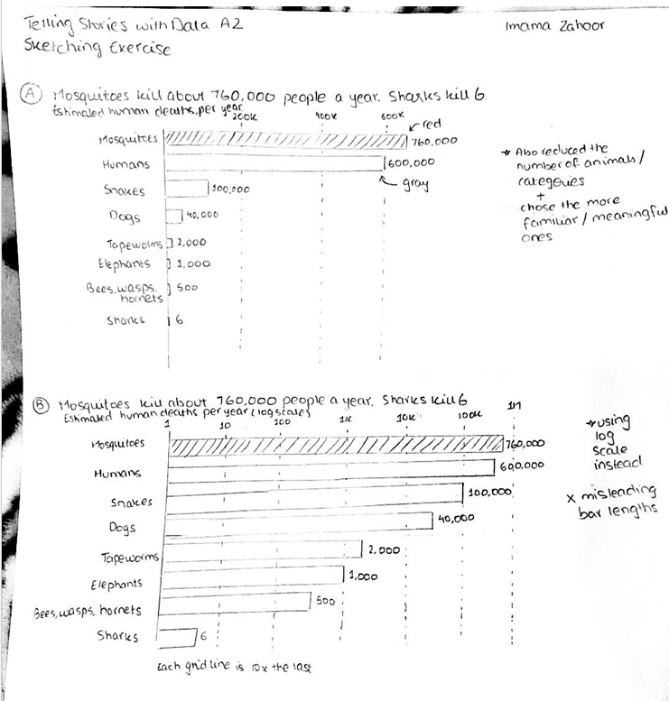
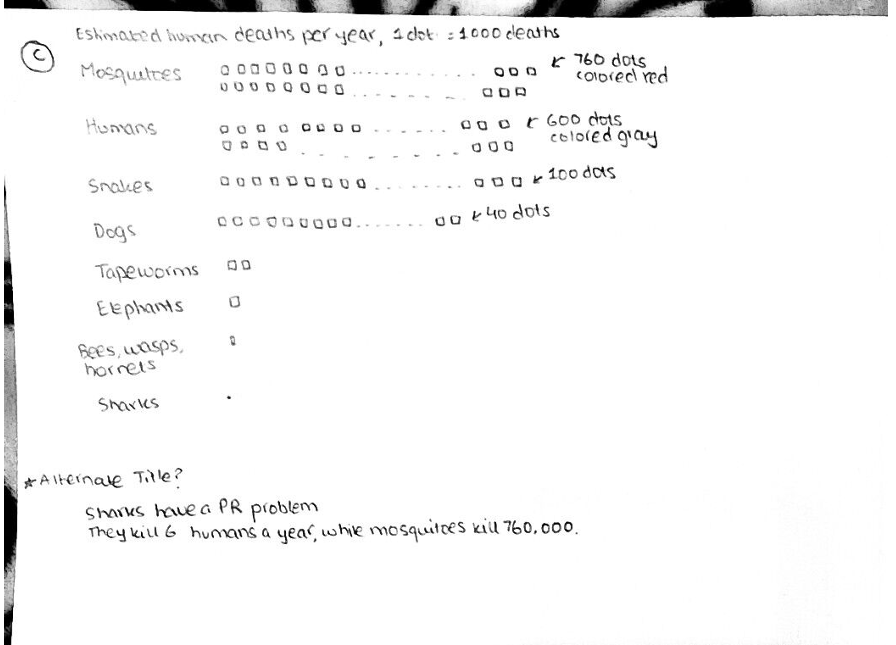

| [home page](https://cmustudent.github.io/tswd-portfolio-templates/) | [data viz examples](dataviz-examples) | [critique by design](critique-by-design) | [final project I](final-project-part-one) | [final project II](final-project-part-two) | [final project III](final-project-part-three) |

# Sharks have a PR problem: redesigning "What are the world's deadliest animals?"
 
For this assignment I took a #MakeoverMonday visualization about the animals that kill the most people each year and redesigned it so the story is clear at a glance. 

## Step one: the original visualization

**Original:** [#MOM 2026 W37 – What are the world's deadliest animals?](https://public.tableau.com/app/profile/matt5450/viz/MOM2026W37-Whataretheworldsdeadliestanimals/MOM2026W37-Whataretheworldsdeadliestanimals) by Matt Meier, created for #MakeoverMonday 2026 Week 37 and published on Tableau Public.

**Data source:** Hannah Ritchie and Fiona Spooner, ["What are the world's deadliest animals, and can we protect ourselves against them?"](https://ourworldindata.org/deadliest-animals), *Our World in Data*, March 2026 (2023 estimates).

<noscript></noscript><object class='tableauViz'  style='display:none;'><param name='host_url' value='https%3A%2F%2Fpublic.tableau.com%2F' /> <param name='embed_code_version' value='3' /> <param name='site_root' value='' /><param name='name' value='MOM2026W37-Whataretheworldsdeadliestanimals&#47;MOM2026W37-Whataretheworldsdeadliestanimals' /><param name='tabs' value='no' /><param name='toolbar' value='yes' /><param name='static_image' value='https:&#47;&#47;public.tableau.com&#47;static&#47;images&#47;MO&#47;MOM2026W37-Whataretheworldsdeadliestanimals&#47;MOM2026W37-Whataretheworldsdeadliestanimals&#47;1.png' /> <param name='animate_transition' value='yes' /><param name='display_static_image' value='yes' /><param name='display_spinner' value='yes' /><param name='display_overlay' value='yes' /><param name='display_count' value='yes' /><param name='language' value='en-US' /></object>
                

I chose this topic because I wanted to tackle something interesting and this topic is also widely misunderstood. Most people think of sharks or other big predators as the deadliest animals, when the answer is actually mosquitoes. I wanted to convey this distinction in a simple manner. I specifically chose this visualization instead of the chart in the original Our World in Data article because I found it very creative. The blood-drop shapes fit the topic and it stands out visually. At the same, when I looked at it as a first-time reader, I had to put in extra effort to find the main point. I wanted to articulate this trade-off between looking good and getting the message across in my critique and redesign. 

**Important note**: The designer of this visualization is also a professional in the data-viz community, so I knew I was not critiquing or redesigning the work of a student.

## Step two: the critique
I like several things about the original design. The visual metaphor of the blood dripping down the chart matches the topic about death. The red highlight against grey drops draws attention while also contributing to the headline finding. The interactive detail panel also works really well with additional context for the viewer. However, the design choices sometimes pull against accurate readings. The drop shapes have a fixed length and only the top position encodes the value. The data label informs the viewer of the exact value, but it is difficult to ascertain which part of the drop it represents on first sight. Additionally, the linear scale squeezes 7 of the 9 categories into the same horizontal line near 0 (Fish and Mollusc have very different values but visually look the same). Lastly, the title is "What are the world's deadliest animals? Click on a drop to show information about this animal type" which is a good call-to-action but does not reveal any major insight or story from the data.

Since this was made for #MakeoverMonday, the main audience is the Tableau and data visualization community. For that audience it is effective. It’s eye-catching and visually appealing, represents the provided dataset, and the main takeaway is quick. It might fall a little short for general viewers who are not familiar with taxonomic groups. Most readers know what an insect or a reptile is, but labels like "Nematode" or "Cnidarian" might be unfamiliar to a general audience and requires effort to work out what those groups are. This adds an extra layer of complexity. 
Overall, I feel like this chart is currently effective as an engaging and explorable piece rather than a deeply informative one. 

My main goal was to simplify the chart so the story is clear. Following were the original goals I came up with:
1. I wanted to start by rewriting a title that conveys a major insight, such as "Mosquitoes kill about 760,000 people a year. Sharks kill 6." 
2. Since taxonomic groups adds additional complexity through unfamiliar (and possibly meaningless) groups such as "Nematodes" (which basically just consists of roundworms), I thought charting individual animals instead would work better. 
3. I would use color only the highlight the main story, so keeping the mosquito bar red and every other bar grey so that the eye goes straight to the main point. 
4. I was particularly excited to try and handle the huge range by either using a log scale with clear labels in a more familiar bar chart style (separating the big two vs. everything else), or experimenting with a unit chart where each icon equals 1,000 deaths (so we can visually separate all categories). 

## Step three: Sketch a solution
I sketched three options:

Sketch A: Linear bars. A sorted bar chart with one red bar. The downside is that small values are hard to see without labels.

Sketch B: Log scale. Every animal is readable, but it makes 760,000 and 100,000 look almost equal so the bar length can be misleading.

Sketch C: Unit chart (1 dot = 1,000 deaths). This was visually the most appealing to me. However, the lower-count animals don't even get one dot.

## Step four: Test the solution

| Question | Interview 1 | Interview 2 | Interview 3 |
|----------|-------------|-------------|-------------|
| What do you think this design is trying to convey?         |  Number of deaths caused by different animals in a year     | That we overestimate the deaths caused by sharks  |  Mosquitoes cause the most deaths in a year    |
| Which of the three sketches do you prefer? Why?       |   Sketch A since it's the most straightforward          | Sketch C is more creative but will also need more work to implement and understand      |     Sketch A because it's simple to understand        |
| What do you like about the sketch? What works?        |  I like the simplicity of the redesign. I can immediately understand what you're trying to say  | I like that you put numbers in front of the bars so I can see what the actual count is        | I like the use of red to highlight. It also complements the new title.       |
| What doesn't work? Is there anything you would change or do differently?        |   The title is reiterating the numbers in the chart. I like your alternative title option more because it's more witty and tells the story.          |  Since you have data labels, you can entirely remove the x-axis            |  Maybe try using icons instead of text for the animals?       |

Based on this feedback, the design changes I decided on were:
- **Go with Sketch A (linear bars)** since it was the easiest to understand. While **Sketch C (unit chart)** was also a popular choice due to the creative nature, it could also be more complicated to understand and implement.
- **Remove the x-axis** since the data labels and subtitle would make it clear what each bar length is representing.
- **Use a more creative title** since the title of my redesign was merely repeating information viewers could gather from the chart. The interviewees seemed to like my alternative title, "Sharks have a PR problem".

I decided not to use the suggestion by interviewee 3 to use icons instead of text for the animals since that could add more complexity to my redesign. 

## Step five: build the solution
Following the feedback, I wanted to rework the title so it better encompasses the main idea. I settled on "Sharks have a PR problem. Mosquitoes are the deadliest animal on Earth", since the second part captures the comparison well. I also changed the animals I included to even more familiar and feared ones. 

<noscript></noscript><object class='tableauViz'  style='display:none;'><param name='host_url' value='https%3A%2F%2Fpublic.tableau.com%2F' /> <param name='embed_code_version' value='3' /> <param name='site_root' value='' /><param name='name' value='MakeoverMondayRedesign_17945085804920&#47;Sheet1' /><param name='tabs' value='no' /><param name='toolbar' value='yes' /><param name='static_image' value='https:&#47;&#47;public.tableau.com&#47;static&#47;images&#47;Ma&#47;MakeoverMondayRedesign_17945085804920&#47;Sheet1&#47;1.png' /> <param name='animate_transition' value='yes' /><param name='display_static_image' value='yes' /><param name='display_spinner' value='yes' /><param name='display_overlay' value='yes' /><param name='display_count' value='yes' /><param name='language' value='en-US' /><param name='filter' value='publish=yes' /></object>
                

## References
- Ritchie, H. and Spooner, F. (2026). "What are the world's deadliest animals, and can we protect ourselves against them?" *Our World in Data*. https://ourworldindata.org/deadliest-animals
- Meier, M. (2026). "#MOM 2026 W37 – What are the world's deadliest animals?" Tableau Public. https://public.tableau.com/app/profile/matt5450/viz/MOM2026W37-Whataretheworldsdeadliestanimals/MOM2026W37-Whataretheworldsdeadliestanimals

## AI acknowledgements
No AI was used to complete this assignment.

