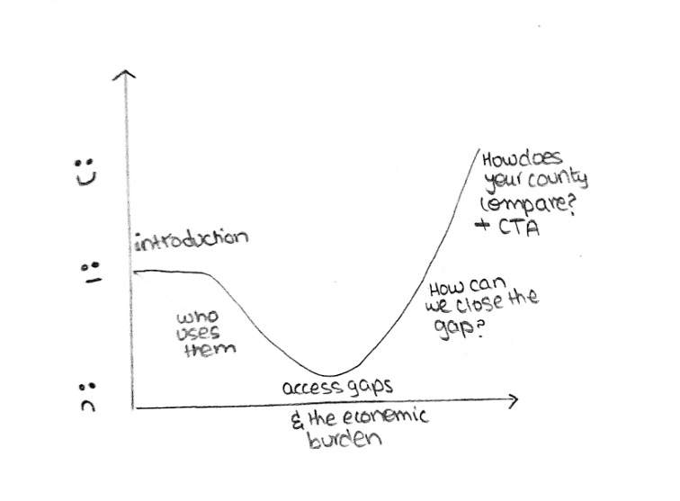
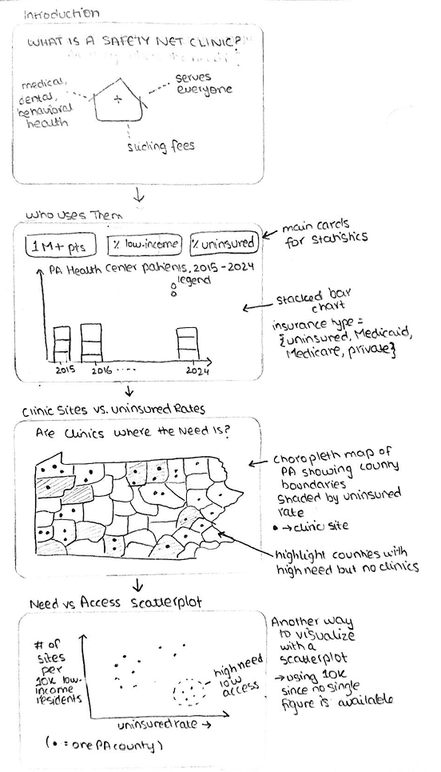
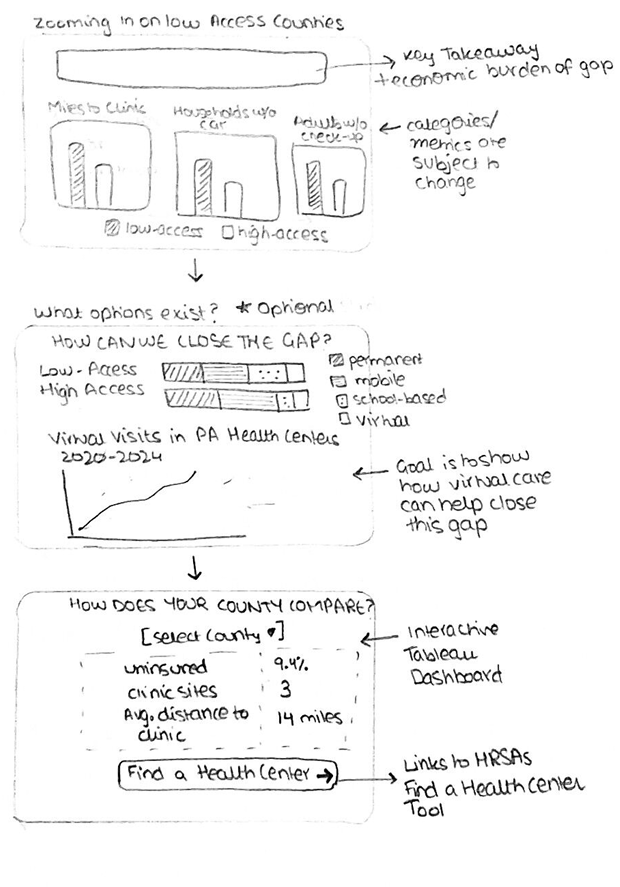

| [home page](https://imamazahoor.github.io/imama-tswd-portfolio/) | [data viz examples](dataviz-examples) | [critique by design](critique-by-design) | [final project I](final-project-part-one) | [final project II](final-project-part-two) | [final project III](final-project-part-three) |

# Outline
Safety net clinics are health centers that treat patients regardless of insurance status or ability to pay. Most are federally qualified health centers (FQHCs) or FQHC look-alikes. They charge on a sliding fee scale based on income and provide primary care, dental care, behavioral health, and services like transportation and translation. Pennsylvania's FQHCs serve more than 1 million patients a year at more than 475 sites, but those sites are in 57 of the state's 67 counties ([reference](https://pachc.org/wp-content/uploads/2025/05/Funding-FQHCs-in-State-Budget.pdf)).

This project looks at whether Pennsylvania's safety net clinics are located where uninsured and low-income residents live. I will compare clinic locations with county uninsured rates, poverty, and health care shortage areas, and identify counties where need is high and clinic access is low. 

> Pennsylvania's safety net clinics serve over a million people, but they are not evenly spread across the state, and some counties with high uninsured rates have few or no clinic sites.

**Audience**

Primary: State and County health departments, as well as nonprofits who need to know where access gaps are. 

Secondary: General readers in Pennsylvania who may not know what safety net clinics are or where they are.

**User Stories**
1. As a Pennsylvania resident, I want to know what a safety net clinic is and whether there is one near me, so that I know where to go for low-cost care.
2. As a resident, I want to see how my county compares with others, so that I understand whether my area is well served.
3. As a public health or nonprofit staff member, I want to see which counties have high need and few clinic sites, so that I can decide where to focus outreach or mobile services.

**Story Outline**
| Stage | Content | Question Answered |
|------|-----|-------------|
| Setup  |  Definition of FQHCs and look-alikes, sliding fee scale, and who they serve. |  What is a safety net clinic? |
|  Setup    | How many Pennsylvanians use them, and how uninsured rates changed from previous years to 2024.    |   How many people depend on them (i.e. the need)?   |
|  Conflict    | Map of clinic sites vs. uninsured rates by county. Identify high-need, low-access counties. |    Are clinics where the need is?     |
| Conflict     | Compare high-need, low-access counties with well-served counties, such as distance to the nearest clinic, and adults without a routine checkup. |  What does the gap mean for residents? What’s the cost of this gap?  |
|   Resolution   | What are a patient’s options in a high-need county, including nearest clinic, mobile units, school-based sites, telehealth.  | What options exist? Where can people go? |

## Initial sketches

# The data
My primary data source is **Health Resources and Services Administration (HRSA)**, which collects standard data from health centers every year, including patient demographics, income, insurance status, and services. Data is available at the national, state, and health center level. It also maintains a list of every health center site with address, and site type (permanent, seasonal, mobile, school-based). I will filter these datasets to Pennsylvania and use them to map clinic locations.

Another major source I will use is the **U.S. Census Bureau**. The Small Area Health Insurance Estimates (SAHIE) provide county-level uninsured estimates for all U.S. counties by age, sex, and income relative to poverty. Since the 2024 estimates were released recently, I will use 2024 as my latest year for all datasets.  

I will join the HRSA and SAHIE data by county FIPS code to create one county-level table for Pennsylvania.

| Name | URL | Data Location | Description |
|------|-----|--------|-------------|
|  HRSA Uniform Data System (UDS), 2024   |  [Data Downloads](https://data.hrsa.gov/data/download)   | [H80-2025.zip](/project_data) and [LAL-2025.xlsx](/project_data) |  Annual data reported by each HRSA-funded health center. Includes patient counts, income, insurance status, services, and visits. Used for patient totals, insurance mix, and trends over time.          |
| HRSA Health Center Service Delivery and Look-Alike Sites     | [Data Downloads](https://data.hrsa.gov/data/download)    | [Health_Center_Service_Delivery_and_LookAlike_Sites.csv](/project_data) | List of every health center site with address, coordinates, county, and site type. Used to map clinic locations, count sites per county, and calculate distance to the nearest clinic.           |
|  Model- Based SAHIE Estimates for Counties and States: 2024    | [U.S. Census Bureau Small Area Health Insurance Estimates (SAHIE), 2024](https://www.census.gov/data/datasets/time-series/demo/sahie/estimates-acs.html)    | [sahie-2024-csv.zip]((/project_data))  | County-level estimates of uninsured residents under 65, by age, sex, and income relative to poverty. Used for county uninsured rates and the number of low-income residents (at or below 200% of poverty).          |
|  Census TIGER/Line Shapefiles    | [TIGER/Line Shapefiles](https://www.census.gov/geographies/mapping-files/time-series/geo/tiger-line-file.2024.html#list-tab-790442341)    |  [tl_2026_42_tract.zip](/project_data) |Census tract boundaries and center points for Pennsylvania. Used to calculate distance from each tract to the nearest clinic site.    |

# Method and medium
The final project will be a scrolling story built in **Shorthand**, with charts, maps, and a simple dashboard built in **Tableau** and embedded in the story. Interactive features will include hovering over maps to see additional data as well as dropdowns in the dashboard so viewers can select specific counties. Data cleaning and joins will be done in Python with the code saved in the repository. 

## References
_Pennsylvania Association of Community Health Centers. Funding FQHCs in State Budget: Fiscal Year 2025–2026: Medical Assistance Programs, CHC Funding in State Budget; $50 Million Request. 2024, pachc.org/wp-content/uploads/2025/05/Funding-FQHCs-in-State-Budget.pdf._

## AI acknowledgements
_No AI was used throughout this assignment._
