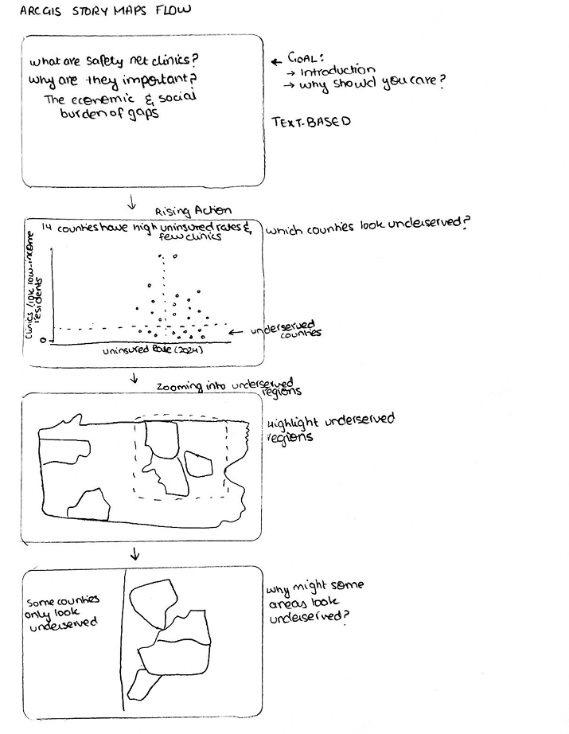
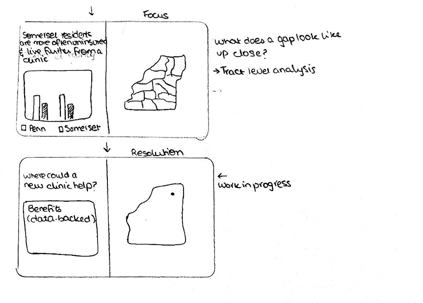

| [home page](https://imamazahoor.github.io/imama-tswd-portfolio/) | [data viz examples](dataviz-examples) | [critique by design](critique-by-design) | [final project I](final-project-part-one) | [final project II](final-project-part-two) | [final project III](final-project-part-three) |

# Changes Since Part 1
## Grading feedback received
- To define my audience and what I want them to do with the information.
- To have a clear story. For example, starting at the state level and then focusing on one or two counties, explaining why some areas look underserved, and showing where a future clinic could go.

## Story
I narrowed my story to one question: **where are the real gaps in safety net clinic access in Pennsylvania?** The story now starts with the whole state, narrows to the 14 counties with high uninsured rates and few clinics, and then focuses on Somerset County. I chose Somerset because it had no clinic site in 2024 and most of its residents live more than 10 miles from a clinic. I added a section that explains why some counties only look underserved. I also plan to show a possible location for a new clinic in Somerset. I removed parts that did not support this question.

## Audience
My main audience is now people who decide where clinics go, such as health center leaders, county health departments, and funders. I want them to see which areas need a new clinic or mobile unit the most.

## Data
I made sure all my data is from 2024. I replaced my 2025 health center (UDS) files with the 2024 files and filtered the clinic site list to sites that existed by the end of 2024. I added the 2023 SAHIE data to show how uninsured rates changed. I removed CDC PLACES because it has no 2024 data for Pennsylvania. I also calculated the distance from each census tract to the nearest clinic.

## Medium
I switched from Shorthand to ArcGIS StoryMaps. StoryMaps lets the map zoom smoothly from the state to Somerset County while showing my data. I still use Tableau for the other non-map charts.

## Revised Story Structure for Part II Storyboarding

| Stage  | Content | Question Answered     | Change from Part I |
|-------|-----|----------|------------|
| Setup | What safety net clinics are and who uses them. Statewide map of clinic sites and uninsured rates. Economic and social burden of underserving.  | What is a safety net clinic, and where are they? | |
| Rising action   | Scatterplot showing 14 counties with high uninsured rates and few clinics. Map highlighting where those counties are. | Which counties look underserved? | Same chart; now incorporates zooming into the underserved counties|
|Conflict | Three reasons a county may only look underserved: Plain communities, clinics across the county line, and small populations. | Are these counties really underserved? | New section |
|Focus| Zoom into Somerset County. Map of each census tract's distance to the nearest clinic. | What does a gap look like up close? |New section. Focuses on one county|
|Resolution| Possible location for a new clinic in Somerset, with distances before and after. | Where could a new clinic help? | New section. Replaces the county lookup and service options. |
|Close |Summary, what decisionmakers could do, limitations, and sources. |What should happen next? | Call to action. |

# Wireframes / storyboards

Draft of ArcGIS StoryMaps: [Safety Net Clinics in Pennsylvania: Where Are the Gaps?](https://arcg.is/0mvPjH1)

**Note:** This is an initial draft version with placeholders. 

# User research 

## Target audience
**Primary audience:** People who decide where clinics go, such as health center leaders, county health department staff, and funders. They need to know which areas most need a new clinic or mobile unit.
 
**Secondary audience:** General readers in Pennsylvania who may not know what safety net clinics are or whether there is one near them.

## Interview script
I want to find out whether readers can follow my story from the state level down to Somerset County, understand each map and chart, and come away knowing where the clinic gaps are. I will show interviewees my draft ArcGIS StoryMap, which includes three finished visuals (statewide map, scatterplot, and Somerset distance map) and placeholders for the parts I have not built yet.

I will interview **at least three people** who represent different parts of my audience:
 
| Interviewee type | Why | How I will find them |
|---|---|---|
| Someone with a public health, health care, or health policy background | Closest to my primary audience | Classmates in Health Care Analytics program |
| A general reader with no health or data background | Tests whether the story is clear for non-experts | Friends or family outside my program |
| A classmate in this course | Gives feedback on design and data visualization choices | Classmates |

| Goal | Questions to Ask |
|------|------------------|
| Learn what the person already knows     |  Have you heard of community health centers or safety net clinics before? What do you know about them? Have you or someone you know ever had trouble finding affordable health care?  |
|  Check if readers can read the scatterplot    |  What is this chart showing? Which counties is the story focusing on? How can you tell? Was anything confusing or hard to read?     |
| Check if readers can read the statewide map	| What does the color show? What do the dots show? Which areas look like they have fewer clinics?|
|Test whether the zoom helps or confuses|	Did the zoom help you follow the story, or was it distracting?|
|Get input on the unfinished sections |	If I showed a proposed clinic location here, what would you want to know about it?|
|Check the main takeaway |	What is the main takeaway of this story, in one sentence? Is there anything missing in this story?|

## Interview findings

### Interviewees
- 1: Classmates in this course
- 2: Health Care Analytics student
- 3. A general reader with little to no context of this course

| Questions               | Interview 1 (briefly describe) | Interview 2 | Interview 3 |
|-------------------------|--------------------------------|-------------|-------------|
| Is the scatterplot clear? Was anything confusing or hard to read? | The chart is a little confusing when comparing with state median and so, could make demarcation lines a bit darker. Make axis titles more clear since it is a little hard to read. Area of interest is in the bottom right so find a way to give them more real estate,           |             | Consider truncating the x-axis at the start since the uninsured rates don't start until 4%            |
| Did the zoom help you follow the story, or was it distracting? |    It helped.                      |             |  The zoom and transitions helped with the flow but think about how they can support the narrative by incorporating the charts within the sidecar instead of breaking the flow to show them. Right now, it seems a little disconnected.    |
| If I showed a proposed clinic location here, what would you want to know about it?    |  Logistics, such as how far it is, how can people access it, and what kind of services would they offer based on county needs.  |             | Connecting it back to the economic and social burden you mention at the start, and show how this can help alleviate some of that.  |
| Is there anything missing in this story? | I didn't know what safety clinics were before this, and I could follow your story arc easily. | | The story itself is clear but think about how you'll incorporate all the individual elements (maps, charts, text etc.) to make it cohesive. Some of the charts are work in progress but make sure to use clear titles and colors for those. |

# Identified changes for Part III
> Document the changes you plan on implementing next week to address any issues identified.  

Text here!

| Research synthesis                       | Anticipated changes for Part III                                                |
|------------------------------------------|---------------------------------------------------------------------------------|
| Findings or observations from interviews | Describe what, if any changes you anticipate making to address the observation. |
|                                          |                                                                                 |
|                                          |                                                                                 |
|                                          |                                                                                 |
| ...add more rows as necessary            |                                                                                 |

> ...include any final thoughts you have here. 

Text here!

## References
_List any references you used here._

## AI acknowledgements
_No AI was used for this part._

